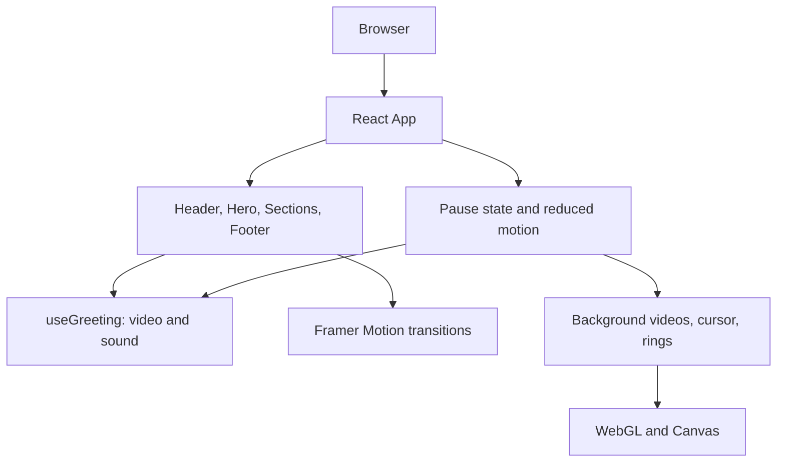
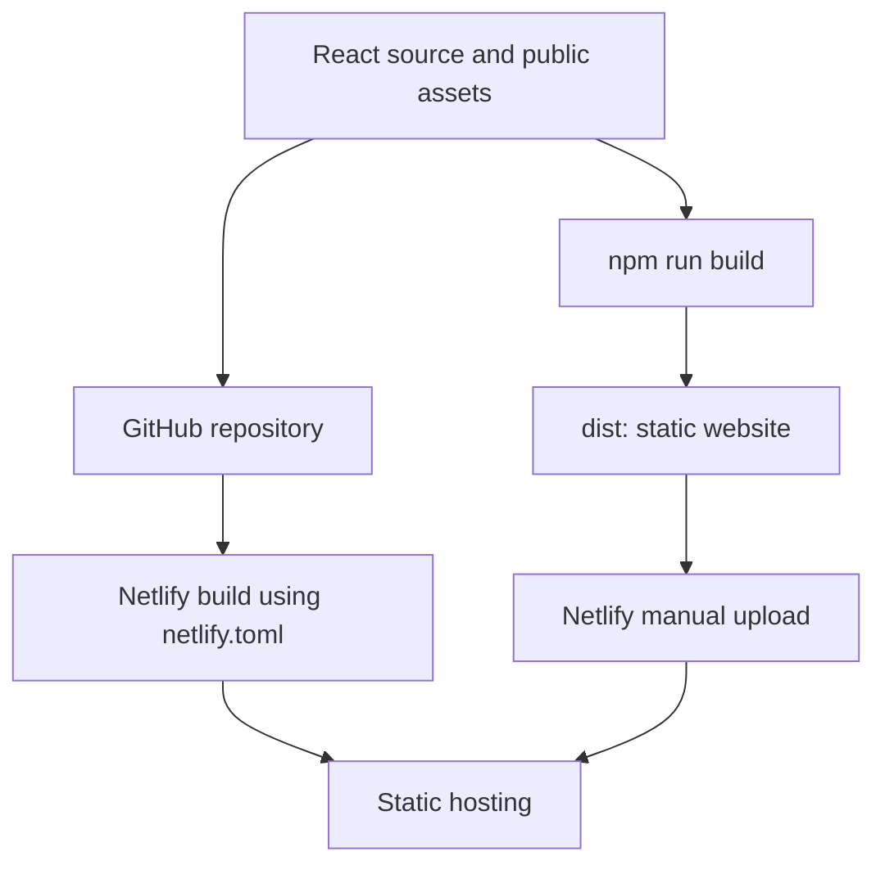

# Website architecture

This project is a static React portfolio. React owns the interface and media state. ScrambleContext distributes the motion policy to ScrambleText components. Framer Motion animates interface elements; Three.js renders decorative rings, while reusable VideoBackground components render the visible page and footer backgrounds. The deployment consists of HTML, CSS, JavaScript, and media files served by Netlify. No API or database is required for the current features.

## Runtime structure

## Module responsibilities

| Location                   | Responsibility                                             |
| -------------------------- | ---------------------------------------------------------- |
| `src/main.jsx`             | Mount the React application                                |
| `src/App.jsx`              | Compose the page and own the shared pause state            |
| `src/components/`          | Visible page sections and accessible controls              |
| `src/hooks/useGreeting.js` | Video reference, sound state, replay and playback feedback |
| `src/effects/`             | Decorative canvas and WebGL lifecycle                      |
| `src/styles/global.css`    | Design tokens, layout, responsive styles and glow states   |
| `public/`                  | Video, posters, cloud noise and HTML shell                 |
| `scripts/`                 | Build, local development and preview commands              |
| `netlify.toml`             | Git-based Netlify build and publish settings               |

## State and interaction

`quiet = userPaused || systemReducedMotion` is computed by App and passed to motion-dependent components. Page and footer background videos pause through the shared VideoBackground component. The cursor trail removes event listeners and cancels its frame loop. The rings render a static frame. Decorative animation resumes when quiet becomes false.

The greeting starts muted. Clicking Sound on or Say hello restarts the video and requests audible playback from the click handler. Sound off mutes the same media element. Playback rejection restores muted state and exposes feedback through a status message. An explicit sound click can play the greeting even when decorative motion is paused.

Each effect owns its DOM reference and cleanup. Effects must cancel animation frames, remove observers/listeners, and dispose GPU objects or call Vanta's destroy method on teardown. Keep controls in React rather than manipulating unrelated UI nodes.

## Compatibility decisions

The regular Three.js package renders the portrait rings. `three-vanta` is an npm alias pinned to Three.js r134 for the older Vanta effects. They remain isolated because upgrading Vanta's renderer without validation could break its shader or render-target assumptions. Vue is removed because React now owns every control.

WebGL effects are decorative and have CSS background fallbacks. Cursor effects run only for fine pointers. Reduced motion suppresses decorative animation. Navigation and content do not depend on WebGL.

## Delivery pipeline

## Limits and future changes

This site presents services and links to existing profiles. It does not collect leads or store user data. Add a backend only for a concrete feature such as a contact submission; keep credentials server-side. Video is a prerecorded avatar greeting, not a live rigged 3D character.

The local development server watches React and CSS; refresh the browser after edits. Restart it after changing public assets. Browser playback and GPU rendering still require manual verification on target devices. The development server is for local preview only; deploy the static output to Netlify.

## Final visual layers

Visible page and footer backgrounds use VideoBackground. Vanta components remain in source as optional alternatives but are not mounted. ScrambleText handles content reveal and hover animations. See docs/SYSTEM-DESIGN.md for visual policies, accessibility, build and operational limits.
